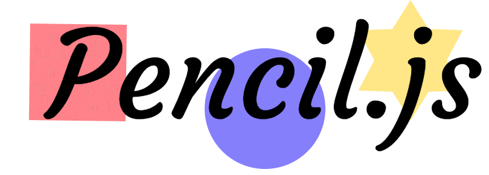

[](https://pencil.js.org)

# :pencil2: Pencil.js
[](https://www.npmjs.com/package/pencil.js)
[](https://snyk.io/test/github/pencil-js/pencil.js)
[](https://github.com/pencil-js/pencil.js/actions/workflows/nodejs.yml)
[](https://www.npmjs.com/package/pencil.js)

Nice modular interactive 2D drawing library.

> [!NOTE]
> You're looking at Pencil.js v4, a TypeScript rewrite. Coming from v3 ? Read the [migration guide](docs/guide/migration.md).


## Installation
You can install Pencil.js with the following command :

    npm install pencil.js


## [CDN](https://developer.mozilla.org/docs/Glossaire/CDN "Content Delivery Network")
On [capable browsers](https://caniuse.com/#feat=es6-module), the easiest way is to import the [ESM package](https://unpkg.com/pencil.js/dist/pencil.esm.js).

```html
<script type="module">
    import { Scene } from "https://unpkg.com/pencil.js/dist/pencil.esm.js";
    
    const scene = new Scene();
</script>
```

If you want to go old-school, you can fetch the script with [unpkg](https://unpkg.com/) or [jsdelivr](https://www.jsdelivr.com/).

```html
<script src="https://unpkg.com/pencil.js"></script>
<!-- or -->
<script src="https://cdn.jsdelivr.net/npm/pencil.js"></script>

<script>
    const scene = new Pencil.Scene();
</script>
```


## Usage
Once you have installed the library using NPM, you can start to import it.

You can either import everything under a namespace or only the package you're going to use. Pick the way that fit your style.

```js
// Just the part you need (recommended)
import { Scene } from "pencil.js";

const scene = new Scene();

/***/

// A single module
import Scene from "pencil.js/scene";

/***/

// The whole package under a namespace
import Pencil from "pencil.js";

const scene = new Pencil.Scene();
```

Pencil.js is fully tree-shakable, any modern bundler ([Vite](https://vite.dev/), [webpack](https://webpack.js.org/) …) will only keep what you use.
TypeScript declarations are included.


## Documentation

The [official documentation](https://docs.pencil-js.vercel.app/) [](https://vercel.com/?utm_source=pencil-js&utm_campaign=oss), built from the [docs folder](docs).


## What Pencil.js do best

### Abstraction
Drawing in a canvas is not trivial.
First of all, the goal is to ease the use of canvas in a browser;
allowing anyone to use it with its comprehensible syntax and extensible options.


### OOP
OOP is great, OOP is almighty, OOP saves lives !
Others library exists, but none with a beautiful OOP syntax.
It makes code look natural, and with TypeScript, your editor knows every option.


### Modularity
Splitting the whole code into modules make everything cleaner.
It also allows you to grab only what you need or replace what you don't like.


### Documentation
A [complete documentation](https://docs.pencil-js.vercel.app/) goes a long way to help developers.
All functions are assured to have a description and typed arguments and returns, the API reference is generated from the source.

### Performance
Pencil.js is able to [draw thousands of shapes](https://benchmarks.slaylines.io/pencil.html) pretty smoothly without tanking your memory.
Even more if you use the [Particles](src/modules/particles) generator.

### Size
With [](https://bundlephobia.com/package/pencil.js), Pencil.js is fairly lightweight.
Furthermore, it's fully tree-shakable: a scene with a circle weighs about 7 kB gzipped.


## Examples
```js
import { Scene, Rectangle } from "pencil.js";

const scene = new Scene(); // create a new scene

const position = [100, 200];
const width = 80;
const height = 50;
const options = {
    fill: "red",
};
const rectangle = new Rectangle(position, width, height, options); // Create a new red rectangle
scene.add(rectangle); // Add the rectangle to the scene

scene.render(); // Render the scene once
```

Take a look at [more advanced examples](https://codepen.io/collection/XqzkNQ/).


## Modules
> Every class lives in its own module, importable on its own (`import Circle from "pencil.js/circle"`).
 * [EventEmitter](docs/modules/event-emitter.md)
   * [Container](docs/modules/container.md)
     * [OffScreenCanvas](docs/modules/offscreen-canvas.md)
       * [Scene](docs/modules/scene.md)
     * [Component](docs/modules/component.md)
       * [.draggable()](docs/modules/draggable.md)
       * [.rotatable()](docs/modules/rotatable.md)
       * [Particles](docs/modules/particles.md)
       * [Path](docs/modules/path.md)
       * [Heart](docs/modules/heart.md)
       * [Line](docs/modules/line.md)
         * [Spline](docs/modules/spline.md)
       * [Polygon](docs/modules/polygon.md)
         * [RegularPolygon](docs/modules/regular-polygon.md)
           * [Star](docs/modules/star.md)
           * [Triangle](docs/modules/triangle.md)
       * [Rectangle](docs/modules/rectangle.md)
         * [.resizable()](docs/modules/resizable.md)
         * [Square](docs/modules/square.md)
         * [Image](docs/modules/image.md)
           * [Sprite](docs/modules/sprite.md)
         * [Text](docs/modules/text.md)
       * [Arc](docs/modules/arc.md)
         * [Pie](docs/modules/pie.md)
         * [Ellipse](docs/modules/ellipse.md)
           * [Circle](docs/modules/circle.md)
       * [Widget](docs/modules/widget.md)
         * [ProgressBar](docs/modules/progress-bar.md)
         * [ProgressPie](docs/modules/progress-pie.md)
         * [Input](docs/modules/input.md)
           * [Button](docs/modules/button.md)
           * [Checkbox](docs/modules/checkbox.md)
           * [Knob](docs/modules/knob.md)
           * [Select](docs/modules/select.md)
           * [Slider](docs/modules/slider.md)
 * [Position](docs/modules/position.md)
 * [Vector](docs/modules/vector.md)
 * [Math](docs/modules/math.md)
 * [Navigation](docs/modules/navigation.md)
 * [Color](docs/modules/color.md)
 * [LinearGradient](docs/modules/linear-gradient.md)
 * [RadialGradient](docs/modules/radial-gradient.md)
 * [ConicGradient](docs/modules/conic-gradient.md)
 * [Pattern](docs/modules/pattern.md)
 * [BaseEvent](docs/modules/base-event.md)
   * [MouseEvent](docs/modules/mouse-event.md)
   * [KeyboardEvent](docs/modules/keyboard-event.md)
   * [NetworkEvent](docs/modules/network-event.md)

### Non-core modules
> Non-core modules refer to packages made by us and not part of Pencil.js library. We find them useful, so maybe you will too...
 * [spritesheet](https://github.com/pencil-js/spritesheet) ([CLI](https://github.com/pencil-js/spritesheet-cli))<br/>
Pack a set of images into a single spritesheet along its json description file.
 * [vue-pencil.js](https://github.com/pencil-js/vue-pencil.js)<br/>
Build reactive 2D graphics scene in your Vue project.
 * [gif](https://github.com/pencil-js/gif)<br/>
Turn any Pencil.js scene into an animated GIF.
 * [text-direction](https://github.com/pencil-js/text-direction)<br/>
Gives the rendering text direction (left to right or right to left) of a node.
 * [canvas-gif-encoder](https://github.com/pencil-js/canvas-gif-encoder)<br/>
Create a GIF stream frame by frame from a canvas rendering context.

## Who is using Pencil.js ?

Take a tour of all the [awesome project using Pencil.js](https://github.com/pencil-js/awesome).


### Enterprises

We are working with Tidelift to deliver commercial support and maintenance for the open source dependencies you use to build your applications.
Save time, reduce risk, and improve code health, while paying the maintainers of the exact dependencies you use. [Learn more.](https://tidelift.com/subscription/pkg/npm-pencil-js?utm_source=npm-pencil-js&utm_medium=referral&utm_campaign=enterprise&utm_term=repo)

## Contributions
You want to help us improve ? Great, here's how to get started:

```sh
npm install
npm run dev        # Playground with hot reload (playground/playground.ts)
npm test           # Unit and visual tests (Vitest with a real canvas renderer)
npm run lint       # ESLint
npm run typecheck  # TypeScript
npm run build      # Build modules, CDN bundles and type declarations
npm run size       # Bundles and tree-shaking report
npm run docs:dev   # Documentation website (VitePress + TypeDoc)
npm run bench      # Compare performances with published versions
```

### Contributors
<!-- ALL-CONTRIBUTORS-LIST:START - Do not remove or modify this section -->
<!-- prettier-ignore-start -->
<!-- markdownlint-disable -->
<table>
  <tbody>
    <tr>
      <td align="center" valign="top" width="14.28%"><a href='https://github.com/GMartigny'><br/>
    <sub><b>Guillaume Martigny</b></sub></a></td>
      <td align="center" valign="top" width="14.28%"><a href='https://github.com/Heraclite'><br/>
    <sub><b>Heraclite</b></sub></a></td>
      <td align="center" valign="top" width="14.28%"><a href='https://github.com/zachary-nguyen'><br/>
    <sub><b>Zachary Nguyen</b></sub></a></td>
      <td align="center" valign="top" width="14.28%"><a href='https://github.com/jaller94'><br/>
    <sub><b>Christian Paul</b></sub></a></td>
      <td align="center" valign="top" width="14.28%"><a href='https://github.com/Marr11317'><br/>
    <sub><b>Rémi Marche</b></sub></a></td>
      <td align="center" valign="top" width="14.28%"><a href='https://github.com/curedbylethe'><br/>
    <sub><b>Parsa</b></sub></a></td>
    </tr>
  </tbody>
</table>

<!-- markdownlint-restore -->
<!-- prettier-ignore-end -->

<!-- ALL-CONTRIBUTORS-LIST:END -->

> All contributions are valued, you can add yourself to this list (or request to be) whatever your contribution is.

## License 

[MIT](license)
